# Drug Shortage Monitor (n8n)

A scheduled n8n workflow that monitors live FDA drug shortage data for a hospital pharmacy scenario. It matches shortages against a watchlist of drugs the hospital depends on, uses an LLM to assess severity and draft alerts, and sends nothing until a pharmacist approves it. Every outcome is written to an audit log.

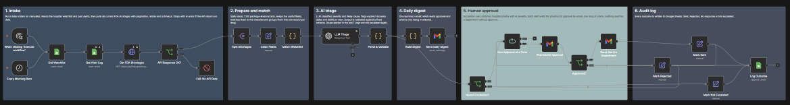

| Stages 1 to 3: intake, matching, AI triage | Stages 4 to 6: digest, approval, audit log |
|---|---|
| 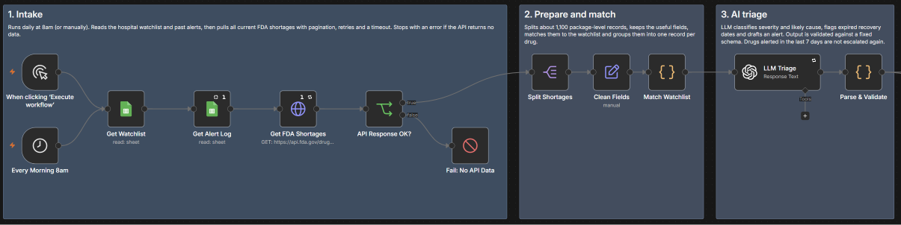 | 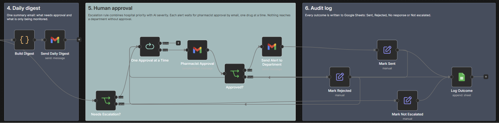 |

## What it does

Every morning at 8am the workflow:

1. Reads a hospital watchlist (Google Sheets) and the history of past alerts.
2. Pulls all current shortages from the openFDA drug shortages API (around 1,100 package-level records), with pagination, retries and a timeout.
3. Matches them to the watchlist and groups them into one record per drug, reducing 1,100+ records to about 12 actionable items.
4. Sends each drug to an LLM, which returns structured JSON with severity, likely cause, expected recovery, a plain-language summary and a draft alert.
5. Validates the LLM output and decides what to escalate, combining the hospital's own priority with the AI's severity assessment.
6. Emails a daily digest of everything in shortage.
7. Sends each escalated alert to a pharmacist for approval by email, one drug at a time. Approved alerts go to the clinical department.
8. Logs every outcome (Sent, Rejected, No response, Not escalated) to an audit sheet.

## How it is built

| Stage | Nodes | Purpose |
|---|---|---|
| 1. Intake | Schedule and manual triggers, Google Sheets, HTTP Request, If, Stop and Error | Load watchlist and alert history, fetch all current FDA shortages, fail loudly if the API returns no data |
| 2. Prepare and match | Split Out, Edit Fields, Code | Flatten records, keep useful fields, match to the watchlist, group per drug |
| 3. AI triage | OpenAI, Code | LLM assessment with a fixed JSON schema, then validation and change detection |
| 4. Daily digest | Code, Gmail | One summary email per run |
| 5. Human approval | If, Loop Over Items, Gmail (send and wait), If, Gmail | Escalation rule, pharmacist approval per drug, send approved alerts |
| 6. Audit log | Edit Fields, Google Sheets | Record every outcome with the AI assessment and the human decision |

A separate error workflow (Error Trigger plus Gmail) emails the failing node, the error message and a link to the execution whenever a scheduled run fails.

## Design decisions

- **Rules for what is calculable, the LLM for what needs language.** Matching, counting, grouping and the escalation decision are deterministic. The LLM only interprets free-text FDA notes and drafts the alert.
- **Constrained LLM output.** The prompt enforces a JSON schema with fixed categories, tells the model to answer "unknown" rather than guess, and includes today's date so expired recovery dates are flagged instead of presented as upcoming. Temperature is set to 0 for consistent classification.
- **Validation before action.** Any LLM response outside the schema raises an error instead of flowing downstream.
- **Human in the loop.** No alert reaches a department without pharmacist approval. openFDA itself states its data is unvalidated, which makes this step essential.
- **Alert fatigue control.** The audit log doubles as state. A drug whose alert was sent in the last 7 days is not escalated again, but still appears in the digest.
- **Business rules live with the business.** The watchlist, including each drug's priority, is a Google Sheet a pharmacist can edit without touching the workflow.
- **Honest audit trail.** Approvals that time out are logged as "No response", not as rejections.

## Failure testing

Failure modes were tested on purpose before going live. Findings and fixes:

| Test | What happened | Fix |
|---|---|---|
| Broken API endpoint | The API returned an HTML error page, the run showed as successful and processed zero records, a silent failure | Response check that converts missing data into an explicit error, which triggers the error workflow |
| Pagination | Only 100 of 1,100+ shortages were fetched, so watchlist drugs could be missed | Pagination driven by the API's own total count, with a page cap and request interval |
| Multiple approvals | The approval node processed only the first of two items and silently dropped the second | Approval wrapped in a loop, one drug at a time |
| LLM dates | A smaller model misjudged recovery dates in 2 of 12 cases | Date rules in the prompt, an explicit true/false field, and a stronger model for this step |
| Repeated runs | The same drug escalated on every run | 7-day change detection based on the audit log |

## Screenshots

| | |
|---|---|
| Live FDA API call | 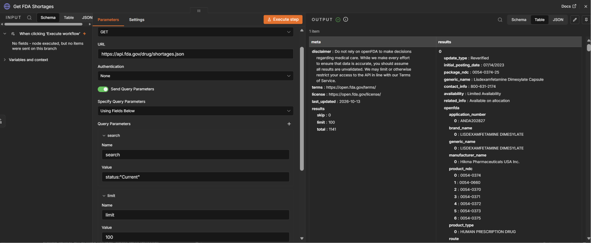 |
| Data intake with item counts | 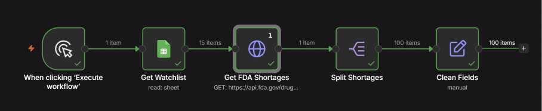 |
| Watchlist matches | 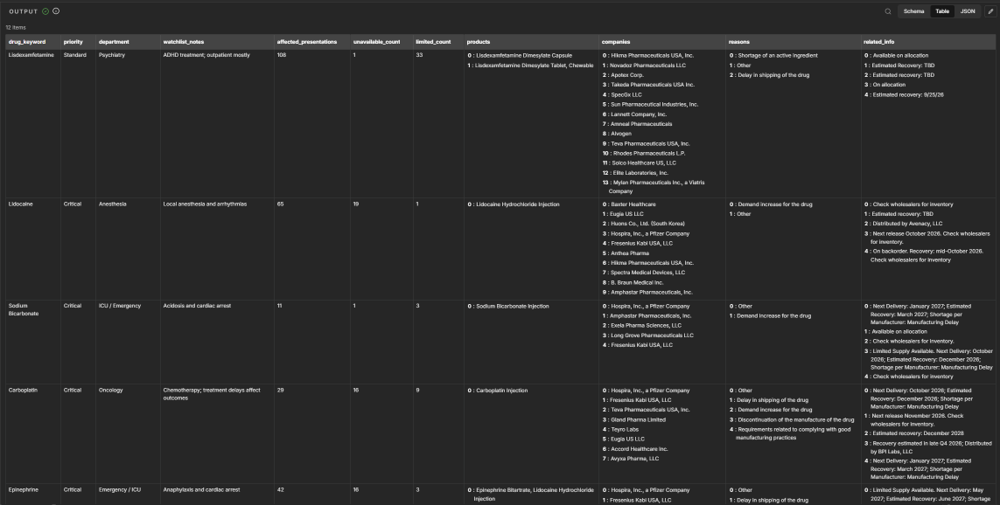 |
| LLM triage output | 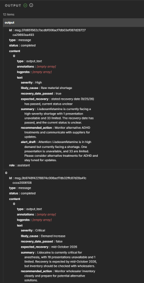 |
| Escalation branch | 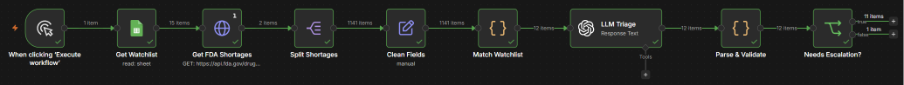 |
| Approval email | 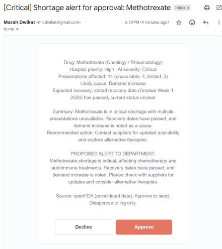 |
| Department alert | 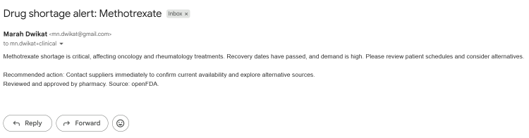 |
| Audit log | 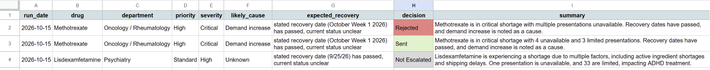 |
| Silent failure caught | 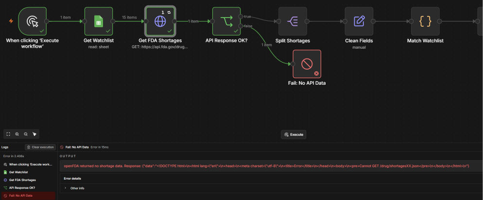 |
| Daily digest | 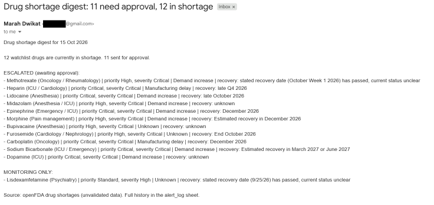 |
| Approval limitation found in testing | 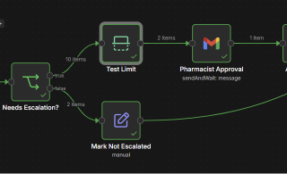 |

## Run it yourself

1. Import `FDA_Drug_Shortage_Monitor.json` and `Drug_Shortage_Monitor_Error_Alerts.json` into n8n (Cloud or self-hosted).
2. Create a Google Sheet with two tabs:
   - `watchlist`: import `hospital_watchlist.csv` (columns `drug_keyword`, `priority`, `department`, `notes`)
   - `alert_log`: headers `run_date`, `drug`, `department`, `priority`, `severity`, `likely_cause`, `expected_recovery`, `decision`, `summary`
3. Add credentials for Google Sheets, Gmail and OpenAI, and select them in the relevant nodes.
4. Replace `YOUR_SHEET_ID` with your sheet, and the `example.com` addresses with your own approver and recipient addresses.
5. In the main workflow settings, select the error workflow and set your timezone.
6. Test with the manual trigger, then activate or publish the workflow for the daily schedule.

## Limitations and next steps

- **Data source.** Built on US FDA data. The Spanish AEMPS supply problems API was the first choice but was not reachable from outside Spain. Because the source is a single node, swapping it is a contained change.
- **Matching.** Keyword matching on generic names can over-match, for example combination products. Matching on national drug codes would be more precise.
- **Approvals are sequential.** Fine for a handful of daily alerts. At higher volume, a single batch approval form would scale better.
- **Re-escalation.** A drug is not re-escalated within 7 days even if its severity worsens. Re-escalating on severity increase is the next improvement.
- **Scenario, not production.** The watchlist and department recipients simulate a hospital pharmacy. Alerts in testing went to test inboxes only.

## Disclaimer

This is a portfolio project. openFDA data is unvalidated and must not be used to make decisions about medical care. Nothing in this workflow is clinical advice.

## Stack

n8n, OpenAI API, openFDA REST API, Google Sheets, Gmail, JavaScript (n8n Code nodes)
